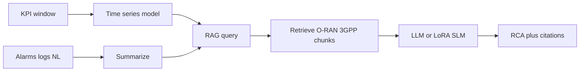

# ClauseGuardRAN

Citation-grounded multimodal root-cause analysis (RCA) for O-RAN troubleshooting: combine KPI time series, alarms/logs, and retrieved O-RAN / 3GPP specification passages into evidence-backed explanations.

Every output is a suggestion for a human to check. **The system never acts on a live network.**

---

## Problem

A support engineer sees an alarm and KPI shift at once — throughput drops, handover counters spike, PRB utilization looks wrong. The explanation is split across two places:

1. **Live measurements** — KPI windows, alarms, logs, natural-language context  
2. **Static specifications** — O-RAN and 3GPP clauses that define what those counters mean and what should happen when they fail  

Confident answers fail for different reasons: the retriever grabbed the wrong clause, or the model ignored the right clause and fell back on pretraining. This project builds a pipeline that surfaces both **fault evidence** and **cited spec passages** so those failure modes are visible.

---

## What this system does

1. Detects fault conditions from **KPI time series** and **textual alarms / logs / NL context**
2. Retrieves supporting passages from a curated **O-RAN / 3GPP** corpus
3. Generates a **root-cause explanation** where claims trace to KPI stats, alarm/log evidence, or cited spec chunks

Experiments compare **KPI-only**, **text-only**, and **KPI + text + RAG**, and whether a **LoRA-adapted small language model** can match a larger general-purpose model when retrieval is held fixed.

### End-to-end pipeline



**Interfaces:** FastAPI (`/query`, `/rca`, `/evaluate`, `/search`, `/health`) and an MCP server exposing the same core as tools (not a second copy of retrieval logic).

---

## End-of-term deliverables

| # | Must ship |
|---|-----------|
| 1 | Rebuildable 20–40 doc corpus, Qdrant index, `/search` and grounded `/query` |
| 2 | TelecomTS `scenarios.jsonl`, golden eval ≥30 (stretch 50–75), Recall@k / MRR runner |
| 3 | KPI (classical + one deep) and text-only baselines on a held-out split |
| 4 | Sequential RCA + Llama 3.1 8B QLoRA vs general LLM; four-row ablation |
| 5 | FastAPI + MCP (3 tools) + one-page UI + three-scenario demo script + report |

**Primary telemetry:** [TelecomTS](https://huggingface.co/datasets/AliMaatouk/TelecomTS). **Spec grounding:** curated O-RAN / 3GPP PDFs with manifest, version tags, and clause-level chunking.

**Project plan:** [docs/progress/ClauseGuardRAN_Project_Plan.pdf](docs/progress/ClauseGuardRAN_Project_Plan.pdf) — overview, Tasks 1–5, backup tasks, and the dated weekly timeline (Sep 1 – Dec 11, 2026). In that plan, the KPI–text fusion model is Task 5 and FastAPI + MCP + demo packaging is Backup Task 1.

---

## Current status (scaffold)

This repository is a **scaffold**: package layout, Docker Compose (Qdrant + API), and placeholders for the 12-week pipeline.

| Area | Status |
|------|--------|
| `GET /health` | Implemented (optional Qdrant ping) |
| `POST /search` | Implemented — typed vector search over indexed specification chunks |
| `POST /query` | Grounded answer with retrieved citations; abstains when evidence is empty or insufficient |
| Experiment data | Validated release cohorts, unchanged input batches and readiness inspection; scored data still needs recording review |
| `POST /rca`, `/evaluate` | Stubs (`501` / `not_implemented`) |
| CLI (`parse_corpus`, `index_corpus`, …) | Corpus parsing/indexing and TelecomTS ingestion implemented; golden/pipeline commands remain stubs |
| MCP tools | Stub (lists planned tool names) |
| UI | Deferred (`src/ui/` placeholder only) |
| QLoRA training | Host GPU later — not in Docker |

Do not expect Week 7 RCA behavior until those modules are implemented.

---

## Repository layout

```text
clauseguard-ran/
├── src/clauseguard/
│   ├── corpus/          # manifest, PDF parse, chunking
│   ├── retrieval/       # embeddings, Qdrant, indexer
│   ├── datasets/        # TelecomTS, scenarios, schemas
│   ├── kpi/             # KPI baselines
│   ├── text/            # text-only classifier
│   ├── rca/             # sequential multimodal pipeline (shared core)
│   ├── llm/             # OpenAI + LoRA hooks
│   ├── eval/            # Recall@k, MRR, runners
│   ├── api/             # FastAPI routes
│   ├── mcp/             # MCP server (Week 11)
│   └── cli/             # operational commands
├── data/                # corpus, scenarios, golden (examples tracked)
├── artifacts/           # eval outputs, traces (gitignored contents)
├── models/              # LoRA adapters (gitignored contents)
├── docker-compose.yml
├── Dockerfile
├── Makefile
├── pyproject.toml
└── uv.lock
```

Local planning notes under `.context/` are **gitignored** and not part of the published tree.

---

## Prerequisites

- Python **≥ 3.11**
- **[uv](https://docs.astral.sh/uv/)** (recommended local package manager)
- **Docker Desktop** (or Docker Engine + Compose) for Qdrant + API
- `NVIDIA_API_KEY` for corpus embeddings and grounded `/query` generation through NVIDIA NIM
- Parsed corpus text is required for indexing. The `llama-nemotron-embed-vl-1b-v2` model
  uses 2048-dimensional vectors with `passage` mode for indexing and `query` mode for search.
  The default collection is `oran_specs_nemotron_vl_2048`. Switching embedding models requires
  a new Qdrant collection and a complete reindex; do not mix vectors from different embedding
  spaces in one collection.

---

## Local setup with uv

This repo already has a `pyproject.toml` and `src/clauseguard` package. After cloning, use **`uv sync`** — do **not** run `uv init` (that scaffolds a *new* project).

```bash
# Install uv once: https://docs.astral.sh/uv/getting-started/installation/

cp .env.example .env
uv sync --extra dev

# Run the API locally
uv run uvicorn clauseguard.api.main:app --reload --port 8000

# In another terminal
curl http://localhost:8000/health
uv run pytest
```

Equivalent via Makefile:

```bash
make install   # uv sync --extra dev
make api       # uv run uvicorn …
make test      # uv run pytest
```

### New project vs this repo

| Situation | Command |
|-----------|---------|
| Starting a brand-new empty project | `uv init` |
| Working in **this** clone | `uv sync --extra dev` then `uv run …` |

---

## Docker setup

Starts Qdrant and the API image (same FastAPI app).

```bash
cp .env.example .env
make up
curl http://localhost:8000/health
make logs    # follow API logs
make down
```

| Service | Ports |
|---------|-------|
| API | `8000` |
| Qdrant | `6333`, `6334` |

Volumes mount `./data`, `./artifacts`, and `./models` (read-only for models). Optional MCP profile: `make mcp` (stub entrypoint).

---

## API surface

| Endpoint | Week | Behavior now |
|----------|------|----------------|
| `GET /health` | 0 | Real liveness (+ optional Qdrant reachability) |
| `POST /search` | 2 | Vector search — embeddings, Qdrant hits, and provenance metadata |
| `POST /query` | 3 | Grounded answer + retrieved citations; returns `not found` when evidence is insufficient |
| `POST /rca` | 7 | Stub — fault + KPI / text / spec evidence |
| `POST /evaluate` | 5 | Stub — golden eval → artifacts |

All non-health routes will eventually call the shared `RcaPipeline` / eval runner rather than duplicating retrieval.

---

## Makefile targets

| Target | Status |
|--------|--------|
| `make install` | Working — `uv sync --extra dev` |
| `make api` | Working — local uvicorn via uv |
| `make test` | Working — `uv run pytest` |
| `make up` / `down` / `logs` | Working — Docker Compose |
| `make parse` | Working — validates and parses acquired PDF/DOCX corpus sources |
| `make index` | Working for parsed text; requires Qdrant and `NVIDIA_API_KEY` |
| `make ingest-telecomts` | Pinned TelecomTS acquisition, validated scenarios and analysis CSVs |
| `make eval` / `e2e` | Stubs |
| `make mcp` | Stub MCP profile |

`make parse` validates every acquired manifest row against the source file under
`data/corpus/raw/`, then extracts PDF and DOCX text to `data/corpus/parsed/`. Each parsed file
uses the corresponding manifest filename stem with a `.txt` suffix (for example, `spec.pdf` maps
to `spec.txt`). `make index` consumes those parsed files, batches NVIDIA embeddings, and writes
citation-ready points to Qdrant.

After indexing, search the retrieved specification passages through the API:

```bash
curl -X POST http://localhost:8000/search \
  -H 'Content-Type: application/json' \
  -d '{"query":"E2SM-KPM downlink UE throughput counter","top_k":3}'
```

The response contains a `results` list with passage text, relevance score, and the
`spec_id`, `section`, `source_file`, and `chunk_id` provenance fields. A valid query with no
matches returns `{"results":[]}`; blank or whitespace-only queries return `422`.

Ask a question grounded in the retrieved passages with `/query`:

```bash
curl -X POST http://localhost:8000/query \
  -H 'Content-Type: application/json' \
  -d '{"question":"What does the E2 interface connect?","top_k":3}'
```

A successful answer includes citations projected from the retrieved chunks:

```json
{
  "answer": "The E2 interface connects the near-real-time RIC and an E2 node.",
  "citations": [
    {
      "spec_id": "O-RAN.WG3.E2AP-R003-v04.00",
      "section": "5.2.2",
      "source_file": "e2ap.pdf",
      "chunk_id": "e2ap-5-2-2-001"
    }
  ]
}
```

If retrieval is empty, or the selected model judges the retrieved evidence insufficient, the
endpoint returns HTTP 200 with `{"answer":"not found","citations":[]}`. Empty retrieval does
not invoke a model. The model sees only retrieved passages, but semantic entailment is not
independently verified. `/query` uses NVIDIA NIM models in priority order; transient rate limits,
timeouts, and gateway errors can fail over to another configured model. Set `NVIDIA_API_KEY` in
`.env` before starting Docker. Model cooldown state is process-local.

To verify the fallback path without intentionally rate-limiting your NVIDIA account, run
`uv run python scripts/smoke_nvidia_failover.py` with `NVIDIA_API_KEY` configured. The script
simulates a 429 response only for the first model request, then sends the fallback request to
NVIDIA and prints the model used and structured response. This is an opt-in live provider check;
the automated failover tests remain fully mocked.

---

## MCP (planned, Week 11)

Exactly three tools, same pipeline as FastAPI:

- `search_o_ran_specs`
- `run_rca`
- `summarize_kpi_window`

---

## Data and provenance

| Role | Source |
|------|--------|
| KPI + NL + RCA labels | TelecomTS |
| Spec grounding | Curated O-RAN / 3GPP PDFs listed in corpus manifest |
| Shape examples | `data/corpus/manifest.example.csv`, `data/scenarios/scenarios.example.jsonl`, `data/golden/golden_eval.example.jsonl` |

Raw PDFs, parsed text, downloaded TelecomTS, scenario/CSV outputs, and model weights are gitignored.
Prepare the pinned TelecomTS release and its analysis environment:

```bash
uv sync --extra dev --extra analysis
uv run python -m clauseguard.cli.ingest_telecomts --revision 1b3a88a440f4922edfcd1e230e42c003c0e13bdf
uv run --extra analysis python -m ipykernel install --prefix .venv --name clauseguard --display-name ClauseGuardRAN
```

Open [the TelecomTS analysis notebook](notebooks/telecomts_analysis.ipynb) using the ClauseGuardRAN
kernel. It reads `data/scenarios/scenarios_overview.csv` and `kpi_samples.csv`, verifies their
hashes, and saves figures in `artifacts/telecomts_eda/`. The CLI writes conversion diagnostics,
source provenance and a CSV schema alongside these tables; existing outputs are protected
from overwrite. Sample CSV missing-value masks distinguish missing values from literal strings.

Implementation progress is recorded in [IMPLEMENTATION_SUMMARY.md](IMPLEMENTATION_SUMMARY.md).
Ingestion preserves observations and reference labels. Task 2.1b now supplies shared splits and
loaders; scored readiness still requires reviewed recording evidence and sufficient class coverage.
See the preparation commands below.

## Shared data for detection and fault categories (Task 2.1b)

The release has **one saved family split** and two task views:

| Task | Examples | Target |
|---|---|---|
| Detection | Eligible normal, synthetic-fault and jammer windows | Normal / abnormal |
| Category | Eligible windows from the ten synthetic categories | Fault category |

Category selection never reshuffles records or removes normal/jammer examples from detection.
The source totals are 30,765 normal, 956 synthetic-fault and 279 jammer windows, before eligibility
checks. The earlier 576-window example described only a synthetic training subset.

Prepare recording evidence separately from splitting:

```bash
uv run python -m clauseguard.cli.prepare_scenarios \
  --stage evidence --output-dir data/scenarios/evidence

uv run python -m clauseguard.cli.prepare_scenarios \
  --stage release --evidence-dir data/scenarios/evidence \
  --output-dir data/scenarios/release --mode exploratory
```

The evidence command acquires missing `metrics.csv` and `description.txt` assets at the existing
acquisition's pinned revision, checks their digests, and matches each window against the raw
measurements and timestamps. Offline acquisition uses `--input-dir` and `--checksums`, just like
JSONL ingestion. `--stage all` (the default) runs both steps. For a new acquisition, append
`--prepare-release` to `ingest_telecomts`; its default release mode is `scored`, with an explicit
`--release-mode exploratory` option for source-trace inspection.

**A raw match is not approval of recording independence.** Evidence starts unresolved. Supply
`--recording-reviews path/to/reviews.json` to the evidence stage after reviewing actual source
records. This file is keyed by processed source path. An unresolved entry looks like:

```json
{
  "normal/mobile/File/processed/chunked.jsonl": {
    "status": "unresolved",
    "recording_id": null,
    "parent_recording_ids": [],
    "candidate_parent_sources": [],
    "evidence": "Recording-session evidence still needs review.",
    "reviewer": "",
    "reviewed_at": null
  }
}
```

A verified review requires a real recording ID, evidence reference, reviewer and ISO review date.
Synthetic traces also require parent recording IDs. Shared recording IDs, parent IDs, candidate
parent-source links, existing provenance links and observed duplicate windows connect whole traces
into families. Every family stays in one split, including overlapping windows. Unresolved candidate
parents cannot remain in a verified review. Do not fill review fields with guessed evidence.
The ingestion `--lineage` sidecar supplies relationships; it does not replace this human review.

`assign_splits` targets 60/20/20 using a deterministic, bounded search over whole families. It
prioritizes normal/abnormal coverage, ten-category coverage and jammer coverage before proportional
sizes. It does not balance labels or fit transformations. A search that cannot supply coverage
reports the missing labels; it does not split a family to satisfy percentages or claim that all
possible assignments were exhausted.

Outputs include:

- `recording_evidence.csv` and `window_sources.csv`: raw matching and separate recording review.
- `evidence.json`: source hashes, relationships and auditable window summaries.
- `splits.json`: authoritative membership; `membership.csv` is its readable inspection view.
- `labels.json`: versioned binary/category targets; `targets.jsonl` keeps answers separate.
- `inputs.kpi.jsonl` and `inputs.text.jsonl`: permitted inputs, with IDs outside predictor payloads.
- `quality.json`: task/modality readiness, class/group/origin counts, exclusions and unknown units.
- `release.json`: release identity, source location and artifact checksums.

Exploratory releases require opt-in for model iteration and never claim scored readiness. A scored
release excludes unresolved families. Run `--mode scored` in a **new output directory** when the
reviewed evidence is available. Exit 0 means the requested tasks pass the selected mode's gates;
exploratory mode checks coverage only. Exit 3 means missing task readiness/coverage with diagnostic
artifacts retained; exit 1 means invalid input or preparation failure. Both KPI tasks are required
by default; `--require-task detection` checks only detection. Existing outputs are not overwritten.
A blocked scored release is a valid diagnostic output, not a dataset ready for training.

```python
from pathlib import Path
from clauseguard.datasets.scenarios import ScenarioDataset

# Default model loading requires a ready scored release.
release = ScenarioDataset(Path("data/scenarios/release"))
for example in release.iter_examples(split="train", task="detection"):
    inputs, target = example.inputs, example.target

# Same membership, filtered to supported fault categories:
category_examples = release.iter_examples(split="train", task="category")
```

For exploratory inspection, construct `ScenarioDataset(..., allow_exploratory=True)`. This does not
make its recording relationships verified. `load_scenario(id)` returns the full source record for
inspection, including excluded records; pass `example.inputs` to predictors, never the raw record.
The loader verifies release hashes, complete membership, family separation, targets and coverage.
It keeps file offsets rather than all KPI arrays in memory. Keep the scenario JSONL at the relative
location recorded in `release.json` (or move the data and release together).

Default KPI inputs are 128 steps by 16 named numeric channels, preserving native values and nulls.
The two categorical protocol channels remain in the source/analysis data. Task 3 owns features,
batching, class weights, sampling and fitted preprocessing, using training data only.

Text inputs need an approved review with `approved_tasks` (`detection` and/or `category`) and
`text_origin` (`independent_observation` or `kpi_derived`). Legacy approval alone does not qualify
text for these experiments. Diagnosis-derived text and direct diagnosis disclosures are withheld;
a lexical check is only a secondary guard, not a substitute for human provenance review. Missing
approved text does not exclude eligible KPI windows. Use `modality="text"` or `"paired"` for those
cohorts, which inherit membership and have their own readiness gates. Golden answer/citation
approval stays in Task 2.2; this release reports eligible incident support, not approved gold.

The notebook optionally inspects the release and adds overlap, binary counts, category/group
coverage and exclusion/text figures. Set `TELECOMTS_RELEASE_DIR` if its path differs from
`data/scenarios/release`; `TELECOMTS_SCENARIO_DIR` selects the matching analysis CSV directory.

### Baseline experiments

Task 3 uses the saved train/dev/test split. Inputs contain 128 samples from 16 numeric KPI
channels. Labels and source details stay outside model inputs. Models will share training code
called from both a notebook and CLI.

Check the data before training:

```bash
uv run python -m clauseguard.cli.inspect_experiment \
  --release-dir data/scenarios/release \
  --output-dir artifacts/experiments/inspection-001
```

The report lists selected windows, missing classes and reasons training is blocked.
Exit codes: `0` ready, `3` valid data but not ready, `1` invalid input.

**Current blocker:** some files may come from the same original recording. An original recording
and any synthetic versions made from it form a **recording family**. Keep that whole family in
one split so train and test do not share the same underlying measurements.

Compare ways to remove overlapping windows:

```bash
uv run python -m clauseguard.cli.audit_window_overlap \
  --release-dir data/scenarios/release \
  --output-dir artifacts/experiments/window-overlap-audit
```

Keeping all training faults and removing overlapping normal training windows reduces training
from 19,089 to 5,381 windows. The audit saves proposed IDs; it does not change the dataset or
resolve recording relationships. Dev/test currently contain 6,590/6,321 windows.

Score or compare saved model runs:

```bash
uv run python -m clauseguard.cli.baseline_runs score artifacts/experiments/rf-test
uv run python -m clauseguard.cli.baseline_runs compare \
  artifacts/experiments/rf-test artifacts/experiments/xgb-test
```

Saved runs include predictions, errors, settings and data IDs. Failed or missing predictions count
as incorrect. Comparisons require the same evaluation cases. Commands refuse to overwrite existing
output directories. No baseline model has been trained yet.

### Golden specification Q&A

`data/golden/spec_qa.jsonl` is the hand-verified seed. Each line has `id`, `question`,
`expected_answer`, `expected_citations` (`[{"spec_id", "section"}]`) and `is_answerable`;
`type` defaults to `spec_qa`. Load and validate it with:

```python
from clauseguard.eval.golden import load_golden, load_known_spec_ids

rows = load_golden(
    "data/golden/spec_qa.jsonl",
    known_spec_ids=load_known_spec_ids("data/corpus/manifest.csv"),
)
```

The loader fails with `path:line: reason` on invalid JSON, missing or unexpected fields,
duplicate IDs, unknown manifest `spec_id`s, and answerability violations (answerable rows need
citations; unanswerable rows need exactly `"not found"` and no citations). The scaffold's
placeholder fields `expected_spec_id`, `expected_section`, `spec_refs_golden` and `scenario_id`
are deprecated and rejected rather than converted. RCA rows are not supported yet. Loading checks
structure and references only, not whether an answer is correct.

Reviewed evidence for each row lives in `data/golden/annotations.jsonl` (source locator, claim
groups, review status). Load with `clauseguard.eval.annotations.load_annotations`.

---

## License

MIT — see [LICENSE](LICENSE).
